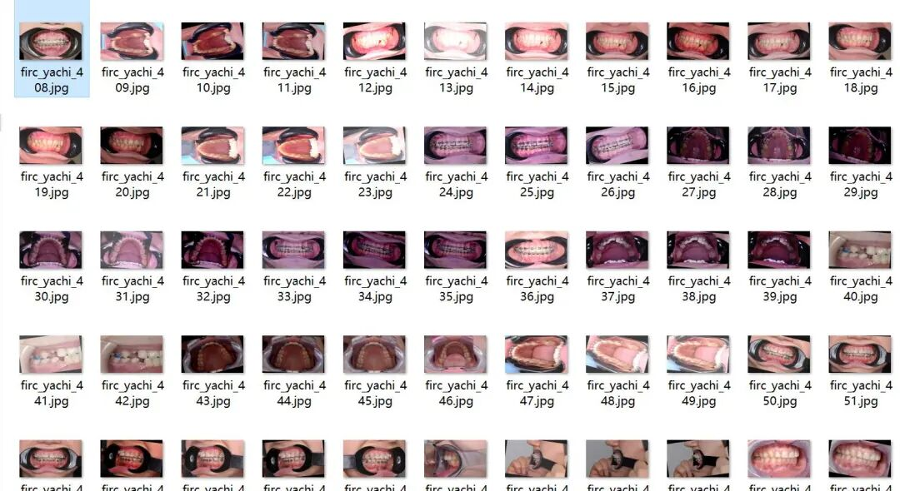
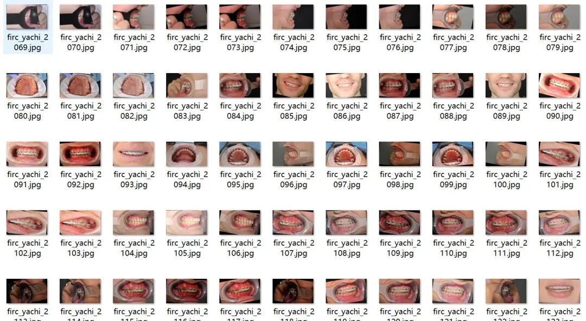
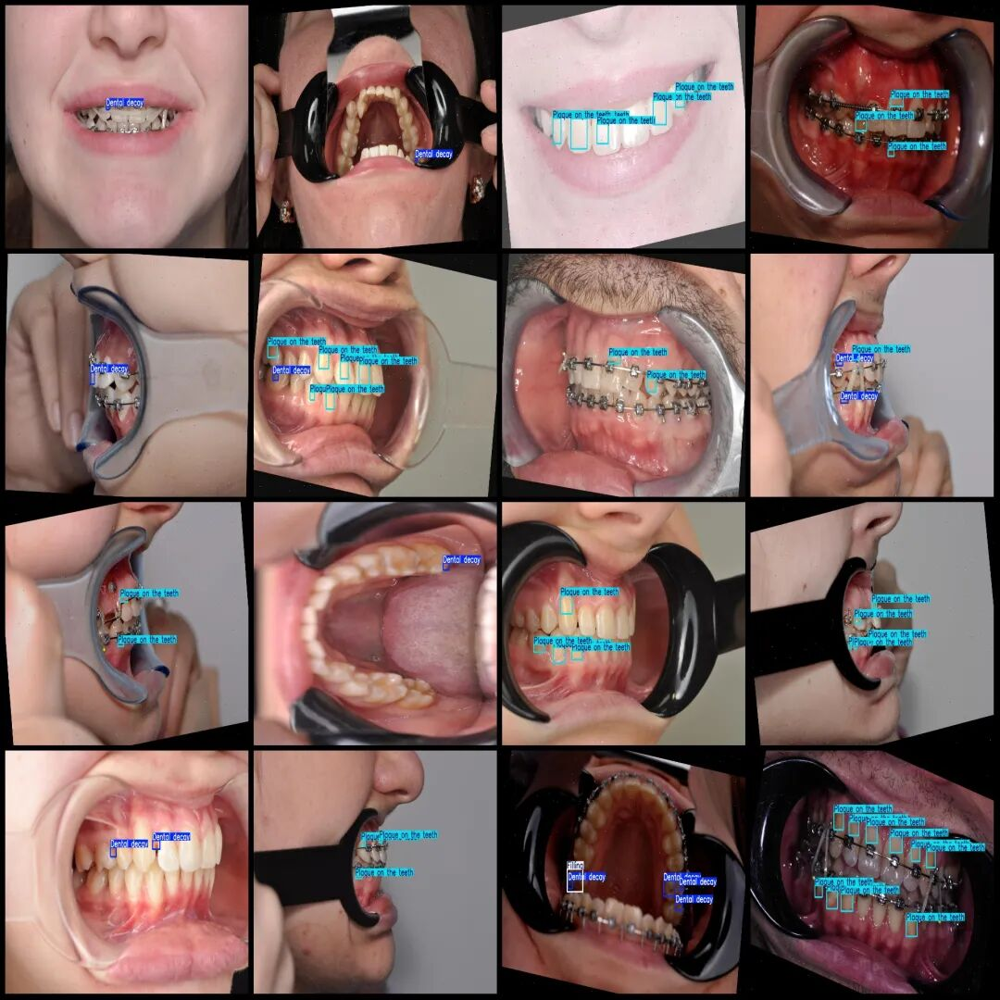

# Oral Disease Detection Dataset VOC+YOLO format with 2706 images in 3 categories

Dataset format: Pascal VOC format + YOLO format (txt file without split path, only containing jpg images and corresponding VOC format xml files and yolo format txt files)

Number of images (number of jpg files): 2706

Number of annotations (number of xml files): 2706

Number of annotations (number of txt files): 2706

Label category count: 3

Label category names (Note that the order of categories in the YOLO format does not correspond to this, but is based on the labels folder's classes.txt): ["Dental decay", "Filling", "Plaque on the teeth"]

Number of boxes labeled in each category:

Dental decay (cavities) frame count = 3440

Filling (filler) Frames = 529

Plaque on the teeth (Dental plaque) Frame count = 7866

Total frame count: 11835

Using labelImg:

Image resolution: 1333x800

Is the dataset enhanced? Yes, about 1100 are original images, and the rest are enhanced generated images.

Annotation rules: Draw a rectangle around the category.

Important Notice: No

Special : This dataset does not guarantee the accuracy of the trained models or weight files.

Image Preview:

Annotation example:

## Payment

Here is a pay link on Stripe ( https://buy.stripe.com/3cs8yP7sY87d0vu9AB ). Please contact me lonlonago@foxmail.com after funding $89, and I will send you a complete data files , thank you!

